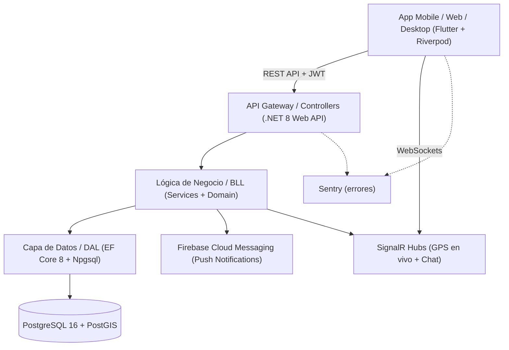

# FletAR

<p align="center">
  
  
  
  
  
  
</p>

**FletAR** es un marketplace de fletes y logística liviana en Argentina. Conecta a
quienes necesitan transportar una carga con fleteros, mediante un esquema de
**subasta a ciegas**, reputación pública, verificación de identidad, chat y
seguimiento GPS en tiempo real.

## Estado

- **API en producción:** <https://fletar-production.up.railway.app> — healthcheck
  [`/api/health`](https://fletar-production.up.railway.app/api/health).
- **Base:** Neon PostgreSQL + PostGIS, migraciones aplicadas al arrancar.
- **Uploads:** volumen persistente de Railway en `/data/uploads`.
- **Android:** AAB y APK release firmados con la key de FletAR y compilados
  contra la URL pública. La publicación en Google Play sigue pendiente
  (cuenta de desarrollador, ficha, Data Safety y testing tracks).
- **Legal:** [Política de Privacidad](https://lucabaello1998.github.io/FletAR/privacidad.html),
  [Términos y Condiciones](https://lucabaello1998.github.io/FletAR/terminos.html) y
  [Eliminación de cuenta](https://lucabaello1998.github.io/FletAR/eliminar-cuenta.html).
- **Eliminación de cuenta:** disponible dentro de la app, en
  **Mi perfil → Eliminar mi cuenta**, y por la página pública de eliminación.

---

## Arquitectura



### Backend (`FLETAR_BACKEND/`)

- **Framework:** .NET 8 LTS (C#), ASP.NET Core Web API en capas (`API`, `BLL`,
  `DAL`, `DTO`).
- **Base de datos y geolocalización:** PostgreSQL 16 + **PostGIS** con
  NetTopologySuite (`geography(Point, 4326)`), consultas de cercanía con
  `ST_DWithin` e índices espaciales GIST.
- **Seguridad y auth:**
  - JWT con rotación de refresh tokens y detección de reúso de familia.
  - Tokens de refresh hasheados con SHA-256.
  - Google OAuth (validación del ID token).
  - Políticas de autorización por claims (`Admin`, `Usuario`).
  - Rate limiting global por usuario/IP y límite estricto en `/api/auth`.
  - Eliminación de cuenta con anonimización, borrado de documentos/fotos y
    revocación de sesiones.
- **Tiempo real:** `UbicacionHub` para GPS en vivo y `ChatHub` para mensajería
  por oferta, con autorización entre las partes.
- **Archivos:** validación de MIME, extensión y magic bytes; almacenamiento
  público aislado (`uploads/publico/`) y privado para documentos de identidad
  (`uploads/privado/`).
- **Monitoreo:** Sentry opcional (`SENTRY_DSN`), sin PII por defecto.

### App cliente (`FLETAR_APP/`)

- **Framework:** Flutter multiplataforma (Android, iOS, Web, Windows).
- **Estado:** Riverpod sin generación de código.
- **Navegación y red:** `go_router` con guardas de autenticación y `Dio` con
  interceptor de refresh single-flight.
- **Mapas:** `flutter_map` + OpenStreetMap.
- **Seguridad local:** `flutter_secure_storage`.
- **Monitoreo:** Sentry opcional (`--dart-define=SENTRY_DSN=...`).

---

## Características

1. **Subasta a ciegas:** los fleteros ofertan sin ver las ofertas de la
   competencia.
2. **Máquina de estados concurrente:**
   `Publicada → OfertaAceptada → EnCurso → Completada / Cancelada`.
3. **Tracking GPS en vivo:** sólo durante un viaje activo y con opt-in explícito.
4. **Chat integrado:** mensajería en tiempo real dentro del contexto de cada
   oferta.
5. **Verificación de identidad:** carga privada de documentos y panel de
   moderación.
6. **Reputación:** calificaciones mutuas post-entrega.
7. **Eliminación de cuenta:** requisito de Google Play y de la Ley 25.326.

8. **Autocompletado de direcciones:** sugerencias de OpenStreetMap (Nominatim)
   que mueven el pin del mapa, y el mapa que completa la dirección al tocarlo
   (sincronización en los dos sentidos, en origen y destino). Si el buscador no
   responde, la dirección se puede escribir a mano igual.

---

## Puesta en marcha local

### Prerrequisitos

- [.NET 8 SDK](https://dotnet.microsoft.com/download/dotnet/8.0)
- [Flutter SDK](https://docs.flutter.dev/get-started/install) (>= 3.22)
- [Docker & Docker Compose](https://www.docker.com/)

### Opción A: todo con Docker

```bash
cd FLETAR_BACKEND
cp .env.example .env   # completar POSTGRES_PASSWORD y FLETAR_JWT_KEY
docker compose up --build
```

La API queda en `http://localhost:8080` (Swagger en `/swagger`) y aplica las
migraciones al arrancar (`FLETAR_MIGRATE_ON_START=true`). PostgreSQL 16 +
PostGIS queda expuesto en el puerto `5433`.

```bash
cd ../FLETAR_APP
flutter pub get
flutter run -d chrome --dart-define=FLETAR_API_URL=http://localhost:8080/api
```

### Opción B: API local + base en Docker

```bash
cd FLETAR_BACKEND
cp .env.example .env   # completar POSTGRES_PASSWORD y FLETAR_JWT_KEY
docker compose up -d db

dotnet ef database update \
  --project src/Fletar.DAL \
  --startup-project src/Fletar.API

cd src/Fletar.API
dotnet run
```

La API queda en `http://localhost:5080` (Swagger en `/swagger`) y la app usa esa
URL por defecto:

```bash
cd ../../../FLETAR_APP
flutter pub get
flutter run -d chrome  # o dispositivo físico/emulador Android
```

### Tests y CI

```bash
# Backend
dotnet test FLETAR_BACKEND/Fletar.sln

# App
cd FLETAR_APP && flutter test && flutter analyze
```

El workflow `.github/workflows/ci.yml` corre backend, tests de Flutter y un smoke
test de Docker Compose en cada push/PR.

---

## Deploy

La guía para publicar la API con Neon (PostgreSQL + PostGIS) y Railway
(Docker + SignalR) está en [`FLETAR_BACKEND/DEPLOY.md`](FLETAR_BACKEND/DEPLOY.md).

Build de producción de la app:

```bash
cd FLETAR_APP
flutter build appbundle --release \
  --dart-define=FLETAR_API_URL=https://fletar-production.up.railway.app/api \
  --dart-define=SENTRY_DSN=https://<public-key>@o<org>.ingest.sentry.io/<project-id>
```

## Backups y monitoreo

- **Base:** dump diario con `.github/workflows/backup.yml` (requiere el secret
  `DATABASE_URL`) y restore window de Neon.
- **Uploads:** [`FLETAR_BACKEND/scripts/backup-uploads.ps1`](FLETAR_BACKEND/scripts/backup-uploads.ps1)
  descarga el volumen de Railway. **El volumen no es un backup.**
- **Detalle operativo:** [`FLETAR_BACKEND/docs/BACKUPS.md`](FLETAR_BACKEND/docs/BACKUPS.md).
- **Errores:** Sentry en API y app; sin DSN queda desactivado.

## Legal

- [Política de Privacidad](https://lucabaello1998.github.io/FletAR/privacidad.html)
- [Términos y Condiciones](https://lucabaello1998.github.io/FletAR/terminos.html)
- [Eliminación de cuenta y datos](https://lucabaello1998.github.io/FletAR/eliminar-cuenta.html)

Los textos son una base operativa para el MVP; conviene que un abogado los revise
antes de la publicación comercial.

## Licencia

Código propietario. Todos los derechos reservados. Ver [LICENSE](LICENSE).
