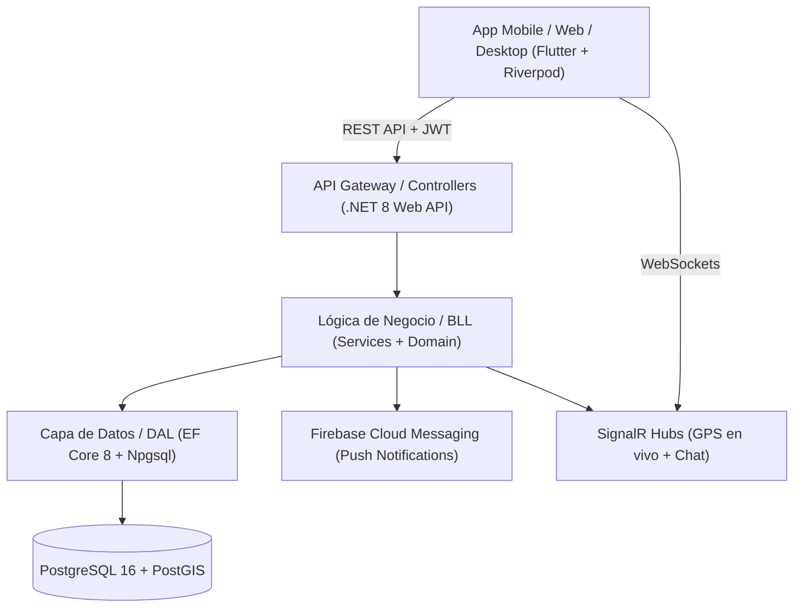

# FletAR

<p align="center">
  
  
  
  
  
  
</p>

**FletAR** es un marketplace de fletes y logística liviana en Argentina diseñado para digitalizar la contratación de transporte de carga y mudanzas. Resuelve el problema de la intermediación informal conectando a publicadores con fleteros mediante un esquema de **subasta a ciegas**, reputación pública, geolocalización y seguimiento en tiempo real.

---

## 🏗️ Arquitectura y Tecnologías

El proyecto está diseñado bajo una arquitectura desacoplada y orientada al dominio:



### 1. Backend (`FLETAR_BACKEND/`)
* **Framework**: .NET 8 LTS (C#), ASP.NET Core Web API en capas (`API`, `BLL`, `DAL`, `DTO`).
* **Base de datos & Geoespacial**: PostgreSQL 16 + **PostGIS** con NetTopologySuite (`geography(Point, 4326)`). Consultas de cercanía eficientes con `ST_DWithin` e índices espaciales GIST.
* **Seguridad & Auth**:
  * Flujo JWT con rotación de Refresh Tokens y **detección de reúso de familia** (invalida toda la cadena si se detecta replay attack).
  * Hasheo de tokens en SHA-256.
  * Autenticación externa con Google OAuth (validación de ID token con Google API).
  * Políticas de autorización basadas en Claims (`Admin`, `Usuario`).
* **Comunicación en Tiempo Real**:
  * `UbicacionHub`: Transmisión de geolocalización en vivo del fletero con validación de publicación activa.
  * `ChatHub`: Canal de mensajería cifrado por oferta con autorización estricta entre partes.
* **Archivos & Media**:
  * Validación estricta por extensión, MIME type y **Magic Bytes** contra spoofing de archivos.
  * Almacenamiento aislado público (`uploads/publico/`) y privado con control de acceso (`uploads/privado/`).

### 2. Aplicación Cliente (`FLETAR_APP/`)
* **Framework**: Flutter (Multiplataforma: Android, iOS, Web, Windows).
* **Gestión de Estado**: Riverpod sin generación de código (mantenibilidad y testing predecible).
* **Navegación & Red**: `go_router` con guardas de autenticación y `Dio` con interceptor de rotación de tokens en vuelo.
* **Mapas & Ubicación**: `flutter_map` + OpenStreetMap (sin depender de claves pagas de Google Maps).
* **Seguridad Local**: Almacenamiento seguro de credenciales con `flutter_secure_storage`.

---

## ✨ Características Principales

1. **Subasta a Ciegas**: Los fleteros envían ofertas sobre las publicaciones sin conocer las ofertas de la competencia, garantizando precios competitivos y transparentes.
2. **Máquina de Estados Concurrente**: Ciclo de vida robusto protegido contra condiciones de carrera:  
   `Publicada` ➔ `OfertaAceptada` ➔ `EnCurso` ➔ `Completada` / `Cancelada`.
3. **Tracking GPS en Vivo**: El solicitante puede ver la ruta y el movimiento en tiempo real del vehículo mientras el flete está en tránsito.
4. **Chat Integrado**: Mensajería directa en tiempo real entre publicador y transportista dentro del contexto de la oferta.
5. **Verificación de Identidad**: Módulo de validación de identidad con carga segura de documentación y panel de moderación administrativo.
6. **Sistema de Calificaciones**: Puntuación mutua (1 a 5 estrellas) con comentarios verificados post-entrega.

---

## 🚀 Puesta en Marcha Local

### Prerrequisitos
* [.NET 8 SDK](https://dotnet.microsoft.com/download/dotnet/8.0)
* [Flutter SDK](https://docs.flutter.dev/get-started/install) (>= 3.22)
* [Docker & Docker Compose](https://www.docker.com/)

### Opción A: todo con Docker (recomendada para probar la API)

```bash
cd FLETAR_BACKEND
cp .env.example .env   # completar POSTGRES_PASSWORD y FLETAR_JWT_KEY
docker compose up --build
```

La API queda en `http://localhost:8080` (Swagger en `/swagger`) y aplica las
migraciones de EF Core al arrancar (`FLETAR_MIGRATE_ON_START=true`). PostgreSQL
16 + PostGIS queda expuesto en el puerto `5433`.

```bash
cd ../FLETAR_APP
flutter pub get
flutter run -d chrome --dart-define=FLETAR_API_URL=http://localhost:8080/api
```

### Opción B: API local + base en Docker

```bash
cd FLETAR_BACKEND
cp .env.example .env   # completar POSTGRES_PASSWORD y FLETAR_JWT_KEY
docker compose up -d db

dotnet ef database update \
  --project src/Fletar.DAL \
  --startup-project src/Fletar.API

cd src/Fletar.API
dotnet run
```

La API queda en `http://localhost:5080` (Swagger en `/swagger`) y la app Flutter
usa esa URL por defecto:

```bash
cd ../../../FLETAR_APP
flutter pub get
flutter run -d chrome  # o dispositivo físico/emulador Android
```

### Tests y CI

```bash
# Backend
dotnet test FLETAR_BACKEND/Fletar.sln

# App
cd FLETAR_APP && flutter test
```

El workflow `.github/workflows/ci.yml` corre backend, tests de Flutter y un
smoke test de Docker Compose en cada push/PR.

---

## 🔒 Endurecimiento y Seguridad

El sistema pasó por una auditoría integral de código y arquitectura, resolviendo:
* Expiración temporal y revocación de autorización de GPS vinculada al estado de la publicación.
* Invalidación forzada de tokens y corte de sesión al desactivar cuentas de usuario.
* Rate limiting y protección contra scraping en endpoints geoespaciales.
* Sanitización y almacenamiento privado de documentos de identidad.

---

## 📄 Licencia

Código propietario. Todos los derechos reservados. Ver [LICENSE](LICENSE).
